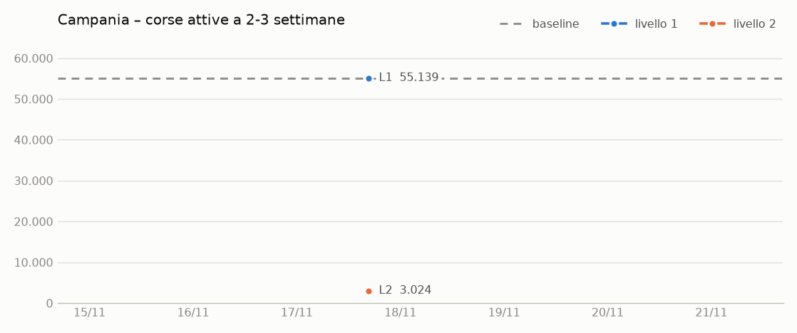

# Report monitoraggio NeTEx

Ultimo controllo: **2026-11-20 18:50:15**  ·  generato il 20/11/2026 18:50

*Corse attive a 2-3 settimane* = corse con almeno un giorno di servizio tra il 14° e il 20° giorno dalla data dell'analisi. La *baseline* è il valore del feed più completo conosciuto per la regione.

## Situazione per regione e livello

| Regione | Livello | Versione | Ultimo esito | Operatori | Corse | Attive 7 gg | Attive 2-3 sett. | vs baseline | Scadute | Analisi del |
|---|---|---|---|--:|--:|--:|--:|--:|--:|---|
| Campania | L1 | 01/11/2026 | nessuna novità | 9 | 74.828 | 60.854 | 55.139 | +0% | 15% | 17/11 |
| Campania | L2 | 30/10/2026 | nessuna novità | 3 | 13.885 | 3.024 | 3.024 | -95% | 78% | 17/11 |
| Piemonte | L1 | 20/11/2026 | nessuna novità | 57 | 79.500 | 56.182 | 45.797 | -0% | 8% | 20/11 |
| Piemonte | L2 | 20/11/2026 | nessuna novità | 21 | 70.616 | 50.200 | 39.460 | -14% | 6% | 20/11 |

Baseline: Campania **55.139** (L1, 01/11/2026), Piemonte **45.994** (L1, 17/11/2026)

## Avvisi aperti

Ultimi avvisi noti per ciascun livello (si aggiornano quando esce una nuova versione).

### Campania

**Livello 1** (versione del 01/11/2026, analisi del 2026-11-17):
- orari in scadenza: BA0007 ha 2,075 corse attive nei prossimi giorni ma 0 tra 2026-12-01 e 2026-12-07
- orari in scadenza: BUSITALIA CAMPANIA ha 3,710 corse attive nei prossimi giorni ma 0 tra 2026-12-01 e 2026-12-07

**Livello 2** (versione del 30/10/2026, analisi del 2026-11-17):
- orari scaduti: 10,856 corse su 13,885 (78%) non hanno piu' giorni di servizio
- operatore senza servizio attivo: BA0007 (28 linee, 2,197 corse, 2,197 scadute, nessuna attiva nei prossimi giorni ne' tra 2026-12-01 e 2026-12-07)
- contenuto: 3,024 corse attive a 2-3 settimane vs baseline 55,139 (-94%)

**Coerenza L1 ⊆ L2** (verifica del 2026-11-17):
- incoerenza livelli: A.T.C. AZIENDA TRASPORTI CAMPANI S.R.L. ha 117 corse attive in L1 e nessuna in L2
- incoerenza livelli: AIR CAMPANIA ha 4,977 corse attive in L1 e nessuna in L2
- incoerenza livelli: ALILAURO ha 13,898 corse attive in L1 e nessuna in L2
- incoerenza livelli: AZIENDA NAPOLETANA MOBILITÀ ha 24,355 corse attive in L1 e nessuna in L2
- incoerenza livelli: CO.SA.T. SOCIETÀ CONSORTILE A R. L. ha 1,051 corse attive in L1 e nessuna in L2
- incoerenza livelli: ENTE  AUTONOMO VOLTURNO ha 8,430 corse attive in L1 e solo 713 in L2 (-92%)

### Piemonte

**Livello 1** (versione del 20/11/2026, analisi del 2026-11-20):
- operatore senza servizio attivo: ITA (2 linee, 56 corse, 56 scadute, nessuna attiva nei prossimi giorni ne' tra 2026-12-04 e 2026-12-10)
- operatore senza servizio attivo: LUFTHANSA (4 linee, 50 corse, 50 scadute, nessuna attiva nei prossimi giorni ne' tra 2026-12-04 e 2026-12-10)
- operatore senza servizio attivo: Nav lago maggiore (69 linee, 735 corse, 735 scadute, nessuna attiva nei prossimi giorni ne' tra 2026-12-04 e 2026-12-10)
- operatore senza servizio attivo: RYANAIR (62 linee, 370 corse, 370 scadute, nessuna attiva nei prossimi giorni ne' tra 2026-12-04 e 2026-12-10)
- operatore senza servizio attivo: S.T.A.C. - SOCIETA' TRASPORTI AUTOMOBILISTICI CASALESI (12 linee, 209 corse, 209 scadute, nessuna attiva nei prossimi giorni ne' tra 2026-12-04 e 2026-12-10)
- operatore senza servizio attivo: TRENITALIA (7 linee, 3,992 corse, 3,992 scadute, nessuna attiva nei prossimi giorni ne' tra 2026-12-04 e 2026-12-10)
- operatore senza servizio attivo: WIZZ AIR (20 linee, 148 corse, 148 scadute, nessuna attiva nei prossimi giorni ne' tra 2026-12-04 e 2026-12-10)

**Livello 2** (versione del 20/11/2026, analisi del 2026-11-20):
- operatore senza servizio attivo: S.T.A.C. - SOCIETA' TRASPORTI AUTOMOBILISTICI CASALESI (12 linee, 209 corse, 209 scadute, nessuna attiva nei prossimi giorni ne' tra 2026-12-04 e 2026-12-10)
- operatore senza servizio attivo: TRENITALIA (7 linee, 3,149 corse, 3,149 scadute, nessuna attiva nei prossimi giorni ne' tra 2026-12-04 e 2026-12-10)

**Coerenza L1 ⊆ L2** (verifica del 2026-11-20):
- incoerenza livelli: ACTP S.r.l. ha 13 corse attive in L1 e nessuna in L2
- incoerenza livelli: Arenaways ha 28 corse attive in L1 e nessuna in L2
- incoerenza livelli: Autolinee Acquesi ha 14 corse attive in L1 e nessuna in L2
- incoerenza livelli: Autolinee Giachino S.r.l. ha 395 corse attive in L1 e nessuna in L2
- incoerenza livelli: Autolinee Nuova Benese S.r.l. ha 223 corse attive in L1 e nessuna in L2
- incoerenza livelli: Autolinee Val Borbera ha 52 corse attive in L1 e nessuna in L2
- incoerenza livelli: Autolinee Valle Pesio S.r.l. ha 46 corse attive in L1 e nessuna in L2
- incoerenza livelli: BUS COMPANY ha 3,678 corse attive in L1 e nessuna in L2
- incoerenza livelli: COAS ha 92 corse attive in L1 e nessuna in L2
- incoerenza livelli: Consorzio GrandaBus ha 853 corse attive in L1 e nessuna in L2
- incoerenza livelli: Giors S.r.l. ha 18 corse attive in L1 e nessuna in L2
- incoerenza livelli: GUNETTO Autolinee S.r.l. ha 149 corse attive in L1 e nessuna in L2
- incoerenza livelli: Nuova S.A.A.R. S.r.l. ha 76 corse attive in L1 e nessuna in L2
- incoerenza livelli: S.A.C. S.r.l. ha 213 corse attive in L1 e nessuna in L2
- incoerenza livelli: SAV Autolinee S.r.l. ha 105 corse attive in L1 e nessuna in L2
- incoerenza livelli: STAC Autoticino ha 228 corse attive in L1 e nessuna in L2
- incoerenza livelli: Trotta Bus ha 154 corse attive in L1 e nessuna in L2

## Andamento

Dati completi: [history.csv](history.csv) · esito dell'ultimo controllo: [last_run.json](last_run.json) · log: [netex_monitor.log](netex_monitor.log)
