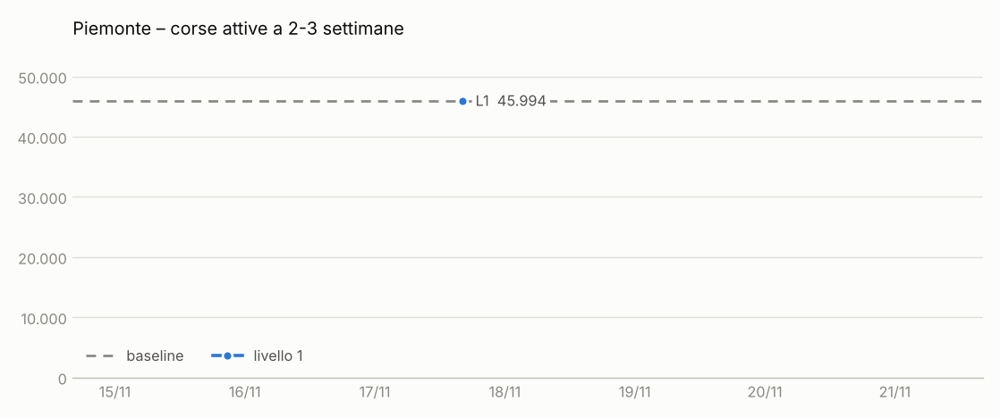

# Report monitoraggio NeTEx

Ultimo controllo: **2026-11-17 15:27:38**  ·  generato il 17/11/2026 17:33

*Corse attive a 2-3 settimane* = corse con almeno un giorno di servizio tra il 14° e il 20° giorno dalla data dell'analisi. La *baseline* è il valore del feed più completo conosciuto per la regione.

## Situazione per regione e livello

| Regione | Livello | Versione | Ultimo esito | Operatori | Corse | Attive 7 gg | Attive 2-3 sett. | vs baseline | Scadute | Analisi del |
|---|---|---|---|--:|--:|--:|--:|--:|--:|---|
| Campania | L1 | 01/11/2026 | nessuna novità | 9 | 74.828 | 60.854 | 55.139 | +0% | 15% | 17/11 |
| Campania | L2 | 30/10/2026 | nessuna novità | 3 | 13.885 | 3.024 | 3.024 | -95% | 78% | 17/11 |
| Piemonte | L1 | 17/11/2026 | ⚠️ avvisi | 57 | 85.452 | 55.888 | 45.994 | +0% | 14% | 17/11 |
| Piemonte | L2 | 17/11/2026 | nessuna novità | 21 | 76.568 | 49.906 | 39.621 | -14% | 13% | 17/11 |

Baseline: Campania **55.139** (L1, 01/11/2026), Piemonte **45.994** (L1, 17/11/2026)

## Avvisi aperti

Ultimi avvisi noti per ciascun livello (si aggiornano quando esce una nuova versione).

Nessun avviso aperto.

## Andamento

*Campania: ancora nessun dato sulle corse attive nello storico.*

Dati completi: [history.csv](history.csv) · esito dell'ultimo controllo: [last_run.json](last_run.json) · log: [netex_monitor.log](netex_monitor.log)
